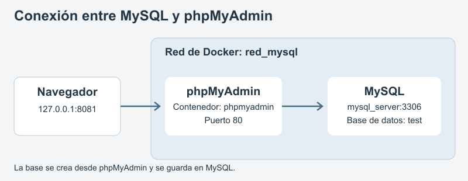
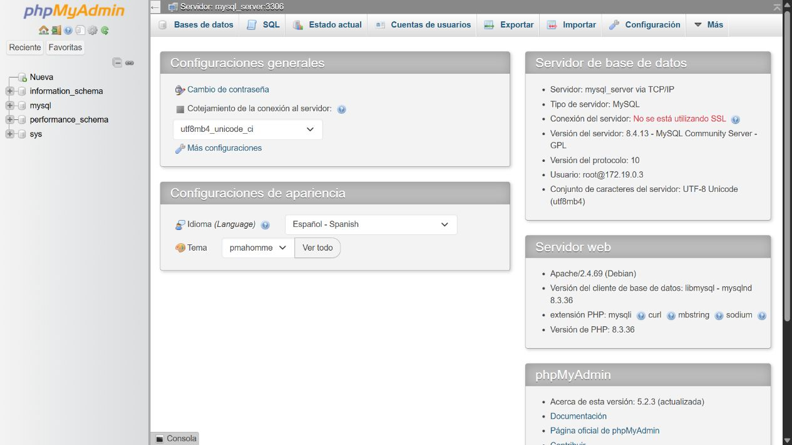
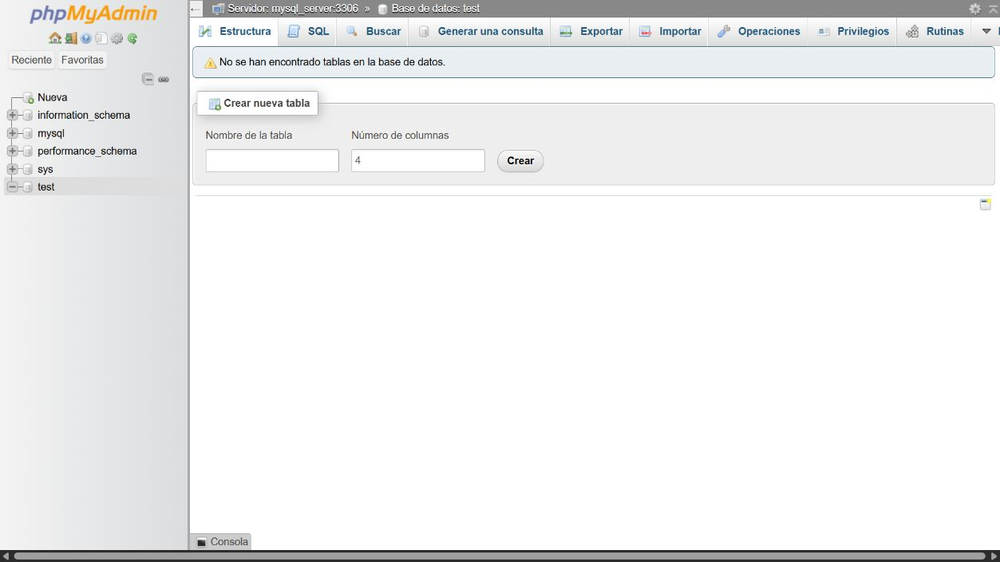
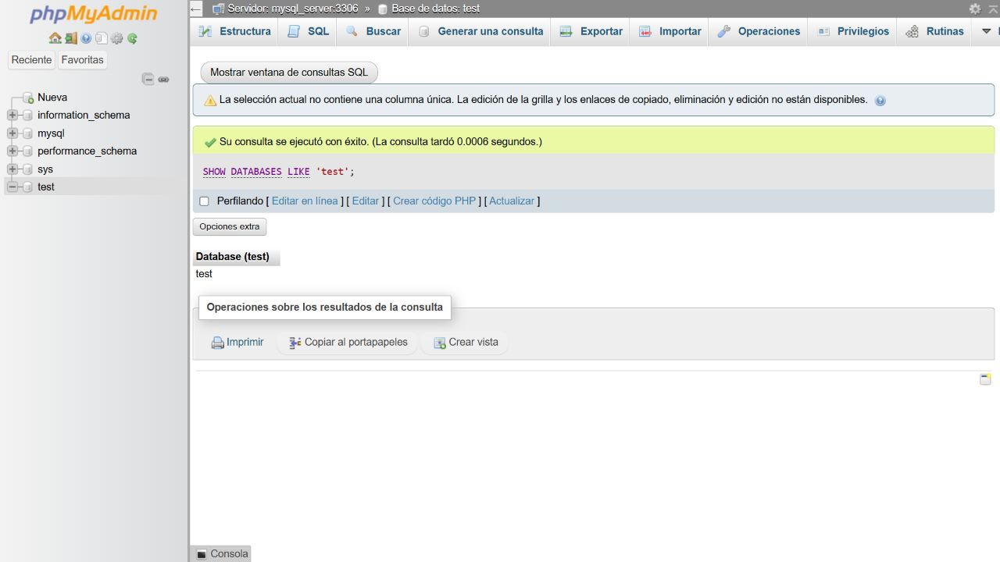

# Práctica: MySQL y phpMyAdmin en Docker

**Nombre:** Carlos Zhuzhingo

**Instituto:** Instituto Tecnológico Sudamericano, Cuenca

**Carrera:** Desarrollo de Software

**Actividad:** Semana 4

**Fecha:** 28 de octubre de 2026

## 1. Título

Conectar MySQL con phpMyAdmin y crear la base de datos test usando Docker.

## 2. Tiempo de duración

Tiempo estimado para realizar y revisar la práctica: aproximadamente 25 minutos.

## 3. Fundamentos

MySQL es un programa para guardar y consultar información en bases de datos. Una base puede contener tablas para organizar distintos tipos de datos. En esta práctica se crea una base llamada test. El objetivo es comprobar la conexión y aprender a crear la base desde una pantalla que se abre en el navegador.

phpMyAdmin es una herramienta que permite administrar MySQL desde una página web. Desde sus opciones se pueden ver las bases disponibles, crear una nueva y escribir consultas SQL. MySQL se encarga de guardar la información y phpMyAdmin permite trabajar con ella. Por eso se usan dos contenedores, uno para cada programa, aunque ambos funcionan en el mismo computador.

Docker permite poner en marcha estos programas a partir de imágenes. Una imagen incluye lo necesario para ejecutar una aplicación. El contenedor es la instancia que se crea usando esa imagen. Para reconocerlos se asignan los nombres mysql_server y phpmyadmin. En esta actividad se usan las versiones mysql:8.4 y phpmyadmin:5.2.

Para que los contenedores se comuniquen se crea una red llamada red_mysql. Los dos se conectan a esa red al iniciarlos. Una red creada por el usuario permite que un contenedor encuentre al otro por su nombre. Así, phpMyAdmin puede buscar el servidor usando mysql_server, sin tener que escribir una dirección IP que podría cambiar al crear otro contenedor.

También hay que indicar el puerto correcto. MySQL recibe las conexiones en el puerto 3306 dentro de la red de Docker. Para abrir phpMyAdmin desde Windows se conecta el puerto 8081 del computador con el puerto 80 de su contenedor. Por eso la dirección del navegador es http://127.0.0.1:8081. Los dos puertos tienen funciones diferentes.

La variable PMA_HOST indica a phpMyAdmin dónde está MySQL y PMA_PORT indica su puerto. La contraseña del usuario root se configura al iniciar MySQL y se usa para entrar al administrador. Después de conectarse, la opción Nueva o Bases de datos permite crear test. Una consulta como SHOW DATABASES LIKE 'test' sirve para comprobar que la base existe. Crear la base y comprobarla son dos pasos distintos.



*Figura 1. El navegador abre phpMyAdmin y este se conecta a mysql_server mediante red_mysql.*

## 4. Conocimientos previos

- Escribir comandos en la terminal.
- Reconocer imágenes y contenedores en Docker.
- Usar un navegador.
- Saber qué es una base de datos y para qué sirve una contraseña.

## 5. Objetivos a alcanzar

- Crear un contenedor con MySQL y otro con phpMyAdmin.
- Conectar los dos contenedores a red_mysql.
- Entrar a phpMyAdmin desde el navegador.
- Crear la base test con las opciones de phpMyAdmin y comprobar que aparece.

## 6. Equipo necesario

- Un computador con Windows, Docker Desktop y WSL2.
- Las imágenes mysql:8.4 y phpmyadmin:5.2.
- Una terminal y un navegador.
- Conexión a Internet para descargar las imágenes.

La práctica se realizó en Docker Desktop del mismo computador.

## 7. Material de apoyo

- Indicaciones de la actividad de la semana 4.
- [Plantilla del informe](https://github.com/maguaman2/informe-tendencias/blob/main/informe.md).
- [Imagen oficial de MySQL](https://hub.docker.com/_/mysql).
- [Imagen oficial de phpMyAdmin](https://hub.docker.com/_/phpmyadmin).
- [Redes bridge de Docker](https://docs.docker.com/engine/network/drivers/bridge/).

## 8. Procedimiento

### Paso 1. Crear la red

Con Docker Desktop iniciado, abrí la terminal y creé una red para los dos contenedores:

```bash
docker network create red_mysql
```

### Paso 2. Crear el contenedor de MySQL

```bash
docker run -d --name mysql_server --network red_mysql -e MYSQL_ROOT_PASSWORD=clave_de_practica -e MYSQL_ROOT_HOST=% mysql:8.4
```

clave_de_practica es una contraseña de ejemplo. En la práctica usé una contraseña privada. MYSQL_ROOT_HOST permite que root se conecte desde el otro contenedor. MySQL queda disponible para phpMyAdmin dentro de red_mysql, en el puerto 3306.

Esperé a que MySQL terminara de iniciar. Revisé su estado con:

```bash
docker logs mysql_server
```

### Paso 3. Crear el contenedor de phpMyAdmin

```bash
docker run -d --name phpmyadmin --network red_mysql -e PMA_HOST=mysql_server -e PMA_PORT=3306 -p 127.0.0.1:8081:80 phpmyadmin:5.2
```

PMA_HOST apunta a mysql_server y PMA_PORT indica el puerto de MySQL. El puerto 8081 permite abrir phpMyAdmin desde el navegador del computador.

### Paso 4. Conectarse desde el navegador

Abrí http://127.0.0.1:8081. Escribí root como usuario y la contraseña configurada para MySQL. phpMyAdmin mostró el servidor mysql_server y la versión 8.4.13 de MySQL.



*Figura 2. Pantalla de phpMyAdmin después de iniciar sesión en mysql_server.*

### Paso 5. Crear test desde phpMyAdmin

Entré en Bases de datos, escribí test en el nombre de la base y pulsé Crear. La base apareció en el panel izquierdo. La creé usando esta opción de la interfaz de phpMyAdmin.



*Figura 3. Base test creada desde las opciones de phpMyAdmin.*

### Paso 6. Comprobar la base

Abrí la pestaña SQL y ejecuté esta consulta de comprobación:

```sql
SHOW DATABASES LIKE 'test';
```

La consulta mostró una fila con el nombre test. Esta consulta comprueba la base que creé en el paso anterior.



*Figura 4. Consulta que permite comprobar la existencia de test.*

## 9. Resultados esperados

La práctica dio estos resultados:

| Comprobación | Resultado obtenido |
| --- | --- |
| Contenedores | mysql_server y phpmyadmin en funcionamiento. |
| Red | Los dos contenedores conectados a red_mysql. |
| Acceso desde el navegador | phpMyAdmin conectado a mysql_server. |
| Creación de la base | test visible en el panel de phpMyAdmin. |
| Consulta SQL | Una fila que muestre test. |

Los dos contenedores quedaron conectados a red_mysql. Pude entrar a phpMyAdmin con las credenciales de MySQL y crear test desde el navegador. La consulta mostró que la base existe.

Los comandos están en [comandos.txt](evidencias/comandos.txt) y la comprobación de la red está en [verificaciones.json](evidencias/verificaciones.json).

## 10. Bibliografía

- Docker, Inc. (s. f.). *mysql: Docker Official Image*. Docker Hub. https://hub.docker.com/_/mysql
- phpMyAdmin. (s. f.). *phpmyadmin: Docker Official Image*. Docker Hub. https://hub.docker.com/_/phpmyadmin
- Docker, Inc. (s. f.). *Bridge network driver*. Docker Docs. https://docs.docker.com/engine/network/drivers/bridge/
- maguaman2. (s. f.). *informe-tendencias* [Plantilla de informe]. GitHub. https://github.com/maguaman2/informe-tendencias
